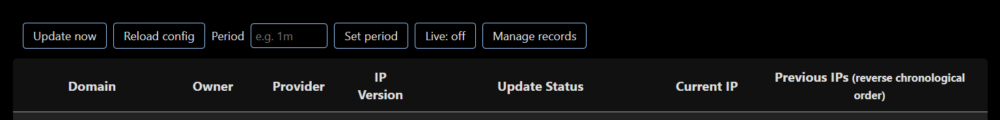
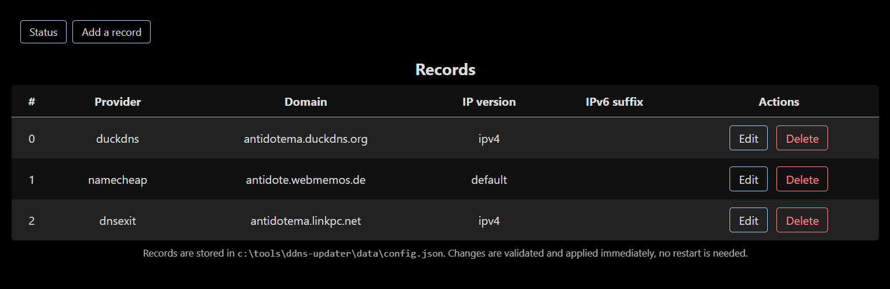
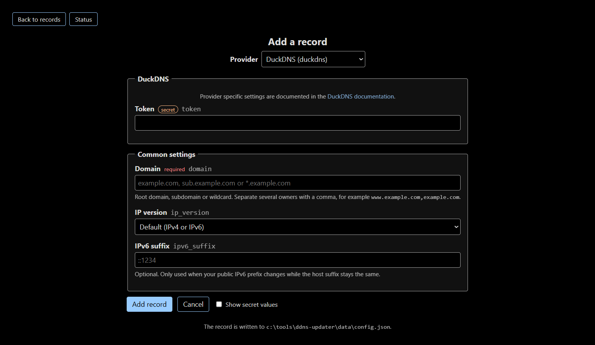

# AntiDote branch changelog

This is the changelog of the fork of [qdm12/ddns-updater](https://github.com/qdm12/ddns-updater)
published at [AntiDoteMA/ddns-updater](https://github.com/AntiDoteMA/ddns-updater).
It documents every change made to the upstream program here, so it is clear
what is local and what is upstream. The main `README.md` links to this file and
otherwise keeps the upstream documentation.

Everything is additive except for the two changed defaults listed below. The
upstream behaviour can be restored by setting the corresponding environment
variables.

---

## 1. Summary

| | Upstream | This fork |
| --- | --- | --- |
| Update period (default) | `5m` | **`1m`** |
| Web UI listening port (default) | `:8000` | **`:12345`** |
| Reload the records configuration | not possible (restart required) | **`GET /reload`** |
| Change the period at runtime | not possible (restart required) | **`GET /reload?period=30s`** |
| DNS resolution | system resolver only | **DNS over HTTPS** (`RESOLVER_DOH_URL`) |
| Web UI buttons | none (the `/update` endpoint existed but had no button) | **Update now**, **Reload config**, period input, **Live refresh toggle** |
| Adding, editing and deleting records | edit the configuration file and restart | **Manage records** pages in the web UI |
| Windows installation | Docker image or manual | **Inno Setup installer** (`windows/`) |

### Why the web UI port changed to 12345

Port 8000 is one of the most commonly used ports on the internet: it is the
default for a large number of web frameworks, development servers and container
images (Jupyter, many Node and Python applications, several official Docker
images). Running ddns-updater next to any of them means the web UI fails to
bind with `address already in use`, and the user has to discover the
`LISTENING_ADDRESS` variable to move it out of the way.

`:12345` is a registered port that is not used by any well known service, and
it is easy to remember and to type. Using it as the default means the web UI
works out of the box in the vast majority of setups.

This only changes the default. The port can still be set to anything with
`LISTENING_ADDRESS` or the equivalent flag, and `8000` remains perfectly
valid:

```sh
docker run -d -p 8000:8000/tcp -v "$(pwd)"/data:/updater/data ghcr.io/qdm12/ddns-updater
```

---

## 2. New features

The screenshots in this section are taken from a running instance and show the
interface changes only, not the updating itself.



*The toolbar: **Update now**, **Reload config**, the period input with
**Set period**, the **Live** toggle and the **Manage records** link.*

### 2.1 Reload the configuration from the web UI

`GET /reload` re-reads the records configuration file, rebuilds the records with
their history restored from the persistent database, and replaces them in the
in-memory database. The web UI shows the new records immediately, and the
periodic updater starts using them on its next cycle.

- If the configuration file cannot be read or parsed, the endpoint returns
  `500` with the error message and **the previous records are kept**.
- Record history is keyed by domain, owner and IP version, so it survives a
  reload and survives entries being reordered in the configuration file.
- The web UI gained a **Reload config** button.

### 2.2 Change the period at runtime

Environment variables are fixed for the lifetime of a process, so a new
settings file was introduced: `data/settings.json` by default
(`SETTINGS_FILEPATH` to override).

```json
{
  "PERIOD": "1m",
  "UPDATE_COOLDOWN_PERIOD": "1m"
}
```

- The file is read at startup and re-read on every reload.
- `GET /reload?period=30s` sets the period, **persists it in the settings file**
  and applies it to the running updater. The new interval takes effect on the
  next tick.
- The web UI gained a period input and a **Set period** button.
- The settings file takes precedence over the `PERIOD` and
  `UPDATE_COOLDOWN_PERIOD` environment variables.

### 2.3 DNS over HTTPS

New setting `RESOLVER_DOH_URL`, for example
`https://cloudflare-dns.com/dns-query`. When set, it is used to resolve the
provider host names and the record host names, and it takes precedence over
`RESOLVER_ADDRESS` and the system resolver.

This was needed because some networks (routers and the ISP resolvers behind
them) filter dynamic DNS domains and return `NXDOMAIN` for them, while plain
DNS on port 53 is blocked on the LAN. DNS over HTTPS on port 443 is not.

Go's resolver on Windows only speaks plain DNS to the servers listed in the
network adapter configuration (`net/dnsconfig_windows.go` in the Go standard
library), and it has no DNS over HTTPS support, so this cannot be solved with
the operating system settings alone.

The HTTP client is also routed through the DNS over HTTPS resolver, since the
provider API host name needs to be resolved too.

### 2.4 Windows installation

`windows/ddns-updater.iss` is an [Inno Setup](https://jrsoftware.org/isinfo.php)
script producing a single setup program which installs the application to
`C:\Tools\ddns-updater`, registers a scheduled task and starts it.

The task runs as the **SYSTEM** account with an **at startup** trigger, so the
application runs at boot without needing anyone to log in. The web UI stays
bound to the loopback interface and remains reachable from the desktop session.

### 2.5 Live refresh in the web UI

The web UI gained a **Live: on / Live: off** toggle button. When enabled, the
records table refreshes every 15 seconds by fetching the page and replacing
only the table body, so the toolbar and the period input keep their state and
the page does not flicker. The table is only replaced when its content
actually changed.

The choice is remembered in the browser's local storage, so it survives a page
reload. It is **off by default**.

The **Update now** button also refreshes the table once it completes, so the
new status is visible without waiting for the next tick.

### 2.6 Add, edit and delete records from the web UI

Upstream only reads the configuration file: adding a record means editing
*config.json* by hand and restarting the program. The web UI gained a
**Manage records** page which lists the configured entries with **Edit** and
**Delete** actions, and an **Add a record** form. This works for all supported
providers, not a hardcoded subset.



*The **Manage records** page: one row per configured entry, with **Edit** and
**Delete**.*

How it works:

1. **Add a record** opens a form. Picking a provider reloads the page with the
   settings that provider accepts, along with a link to its documentation.
1. The entry is validated with `params.ValidateEntry`, the same code used when
   reading *config.json*, so the form cannot produce an entry the program would
   refuse to start with.
1. The configuration file is written atomically (temporary file, then rename),
   keeping the file permissions and any unknown top-level keys, and the new
   records are applied in memory without restarting the program. If the rebuild
   fails, the previous file is restored and the error is shown in the page.



*The **Add a record** form, here for DuckDNS: the provider block is generated
from the provider source, followed by the settings common to every provider.*

A few things to know:

- The configuration file is rewritten with four space indentation and keys
  sorted alphabetically, so comments and hand-made formatting are not
  preserved. Unknown top-level keys in the file are kept as they are.
- The web interface has **no authentication**: anyone who can reach
  `LISTENING_ADDRESS` can read and change your records, including your provider
  credentials. Keep it on localhost or behind an authenticating reverse proxy,
  as already recommended for the whole web interface.
- Editing is disabled, with a message shown in the page, when the `CONFIG`
  environment variable is set. That variable takes precedence over the
  configuration file, so a change written to the file would be overwritten on
  the next reload. Unset `CONFIG` and restart the program to edit from the web
  interface.
- State-changing requests must be same-origin and form-encoded, so a page on
  another site cannot alter the configuration. This is not a substitute for
  authentication, only protection against cross-site requests.
- The provider forms are generated from the provider source code. If you add or
  change a provider, regenerate them with `go generate ./internal/provider/schema`.

---

## 3. New environment variables

| Variable | Default | Description |
| --- | --- | --- |
| `RESOLVER_DOH_URL` | *(empty)* | DNS over HTTPS server URL, for example `https://cloudflare-dns.com/dns-query` |
| `SETTINGS_FILEPATH` | `<datadir>/settings.json` | JSON settings file, re-read at runtime |

---

## 4. New HTTP endpoints

| Endpoint | Description |
| --- | --- |
| `GET /reload` | Re-reads the records configuration and the settings file |
| `GET /reload?period=30s` | Sets the period, persists it and reloads |
| `GET /entries` | Lists the configured records with edit and delete links |
| `GET /entries/new?provider=cloudflare` | Add form for a provider |
| `GET /entries/{index}/edit` | Edit form for the record at that position |
| `POST /entries` | Creates a record |
| `POST /entries/{index}` | Updates the record at that position |
| `POST /entries/{index}/delete` | Deletes the record at that position |

`index` is the position of the entry in the `settings` array of the
configuration file, which is what the page shows. The records are re-read on
every request, so the page reflects manual edits to the file as well.

All of them are unauthenticated, like the rest of the web UI, and the entry
changes additionally require a same-origin form submission. Keep the listening
address on the loopback interface unless the network is trusted.

---

## 5. New files

| File | Lines | Description |
| --- | --- | --- |
| `internal/doh/doh.go` | 233 | DNS over HTTPS client (RFC 8484), built on `github.com/miekg/dns` |
| `internal/doh/doh_test.go` | 110 | Offline tests against a fake DNS over HTTPS server |
| `internal/settings/settings.go` | 121 | JSON settings file, read and written at runtime |
| `internal/settings/settings_test.go` | 153 | Tests for the settings file |
| `internal/reload/service.go` | 187 | Reload service: rebuilds the records and applies the settings |
| `internal/server/reload.go` | 51 | `/reload` handler |
| `internal/server/reload_test.go` | 102 | Tests for the handler |
| `internal/update/service_test.go` | 49 | Tests for `SetPeriod` and `SetCooldown` |
| `internal/configfile/configfile.go` | 225 | Atomic read/modify/write of the configuration file |
| `internal/configfile/configfile_test.go` | 244 | Tests, including permissions and unknown top-level keys |
| `internal/provider/schema/schema.go` | 263 | Provider field metadata: labels, help, secret flags |
| `internal/provider/schema/fields_gen.go` | 569 | Generated field tables, generated from the provider source |
| `internal/provider/schema/schema_test.go` | 152 | Tests: every provider covered, every documentation path exists |
| `internal/provider/schema/gen/main.go` | 354 | AST generator behind `go:generate` |
| `internal/reload/entries.go` | 233 | Entry create, update and delete on the configuration file |
| `internal/reload/entries_test.go` | 225 | Tests for the entry operations and the rollback |
| `internal/server/entries.go` | 319 | List, form and mutation handlers |
| `internal/server/entries_test.go` | 731 | Route, validation and guard tests |
| `internal/server/index_test.go` | 70 | Regression test: the index table renders record markup |
| `internal/server/entry_form.go` | 202 | Form values to JSON entry conversion |
| `internal/server/ui/entries.html` | 72 | Records list page |
| `internal/server/ui/entry_form.html` | 142 | Add and edit form page |
| `windows/ddns-updater.iss` | | Inno Setup script |
| `windows/install-scheduled-task.ps1` | | Registers and starts the scheduled task |
| `windows/uninstall-scheduled-task.ps1` | | Stops and removes the scheduled task |
| `windows/run-ddns-updater.cmd` | | Launcher holding the environment variables |
| `windows/run-ddns-updater.vbs` | | Hidden launcher used by the scheduled task |
| `readme/webui-toolbar.png` | | Screenshot: toolbar with the new buttons and the **Manage records** link |
| `readme/webui-records.png` | | Screenshot: records list with **Edit** and **Delete** |
| `readme/webui-record-form.png` | | Screenshot: **Add a record** form for DuckDNS |

---

## 6. Modified files

| File | Change |
| --- | --- |
| `internal/reload/service.go` | Split into `Reload` (locking) and `reloadLocked` (no locking) so the record operations can reuse it |
| `internal/params/json.go` | Exported `ParseSettings` and `ValidateEntry`, new `ErrInvalidEntry` |
| `cmd/ddns-updater/main.go` | Wiring: the HTTP client resolves through DNS over HTTPS, the reload service is created and passed to the server as reloader and entry manager, the settings file is applied at startup, `readRecords` moved to `internal/reload` |
| `internal/config/update.go` | Default period `5m` → `1m` |
| `internal/config/server.go` | Default listening address `:8000` → `:12345` |
| `internal/config/resolver.go` | New `RESOLVER_DOH_URL` setting |
| `internal/config/paths.go` | New `SettingsFile` path setting |
| `internal/config/settings_test.go` | Golden settings summary updated |
| `internal/data/memory.go` | New `SetAll()` to replace the records atomically |
| `internal/resolver/resolver.go` | Returns a `LookupIPer` interface, uses DNS over HTTPS when configured, adds an `IPResolver` adapter for the health package |
| `internal/resolver/settings.go` | New `DOHURL` setting |
| `internal/server/handler.go` | Templates parsed into one `html/template` set instead of `text/template`, `reloader` and `entryManager` fields, `/reload` and `/entries` routes |
| `internal/server/interfaces.go` | New `ConfigReloader` and `EntryManager` interfaces |
| `internal/server/server.go` | `New()` takes the reloader and the entry manager |
| `internal/server/index.go` | Renders through the shared template set |
| `internal/server/ui/index.html` | Toolbar with the new buttons and the period input, **Manage records** link |
| `internal/server/ui/static/styles.css` | Styling for the toolbar, the status message and the record pages |
| `internal/update/service.go` | `SetPeriod` and `SetCooldown`, ticker reset, concurrent-safe access |
| `internal/backup/service.go` | The backup now archives the **configured** configuration file instead of hardcoding `<datadir>/config.json` |
| `Dockerfile`, `docker-compose.yml`, `k8s/base/*` | Port updated to 12345 |
| `README.md` | Documented `RESOLVER_DOH_URL`, added the link to this changelog. Fork-specific sections live here instead of in the readme |
| `.gitignore` | Excludes the local `data` directory and the work-board state |

---

## 7. Behaviour notes and gotchas

- **The configuration file must not have a UTF-8 BOM.** PowerShell's
  `Set-Content -Encoding UTF8` adds one and the application then fails with
  `cannot unmarshal common settings: invalid character ''`. Write it with:

  ```powershell
  [System.IO.File]::WriteAllText($path, $json, (New-Object System.Text.UTF8Encoding($false)))
  ```

- **Relative paths resolve against the working directory**, not against the
  executable location. The launcher sets the working directory explicitly.
- **The web UI has no authentication.** Keep it on `127.0.0.1`.
- **The index table renders markup built in Go.** Providers and the record code
  return HTML in `models.HTMLRow` (domain and provider links, status spans), and
  the page is parsed with `html/template`, so `internal/server/index.go` converts
  the fields to `template.HTML` before rendering. Assigning those strings
  directly makes the table show the tags as text.
- A name which has no address of the requested type returns the error
  `no such host`, matching the Go resolver, so that the updater treats a
  missing AAAA record as "no IPv6 address" rather than retrying.

### File layout

The records configuration lives in the data directory, as it does upstream:

```text
C:\Tools\ddns-updater\
├── ddns-updater.exe
└── data\
    ├── config.json         the records to watch and the credentials
    ├── settings.json       the runtime settings, re-read at runtime
    ├── updates.json        the record history
    └── ddns-updater.log    the application log
```

`CONFIG_FILEPATH` and `SETTINGS_FILEPATH` point at those files explicitly, so
the layout does not depend on the working directory.

Upstream's backup service archived `<datadir>/config.json` unconditionally,
which ignores the `CONFIG_FILEPATH` setting. It now archives the configured
file instead, which also fixes it for anyone setting `CONFIG_FILEPATH` to
another location.

### The `windows/` directory mirrors the installed layout

`windows/` holds everything needed to run the application on Windows, and
mirrors the installed layout exactly:

```text
windows\
├── ddns-updater.exe        the built executable
├── data\
│   └── config.json         the records to watch and the credentials
├── run-ddns-updater.cmd    the launcher
├── run-ddns-updater.vbs    the hidden launcher
├── install-scheduled-task.ps1
├── uninstall-scheduled-task.ps1
├── ddns-updater.iss        the Inno Setup script
```

Copying the whole directory to another location works as is: the scripts find
their own path (`%~dp0`, `$PSScriptRoot`), the launcher creates the `data`
directory if it is missing, and it falls back to `config.json` in the root of
the installation directory if there is none in `data\`. Only
`install-scheduled-task.ps1` has to be re-run afterwards, since the scheduled
task stores the absolute path of the launcher at registration time.

---

## 8. Testing

```powershell
go build ./...
go test ./internal/configfile/... ./internal/provider/schema/... ./internal/reload/... ./internal/server/... ./internal/doh/... ./internal/settings/... ./internal/update/... ./internal/config/...
```

> `go test ./...` also runs the provider tests, which call the real provider
> APIs and can hang without network access to them.

---

## 9. Building and installing on Windows

`windows/output/ddns-updater-setup.exe` is the **Inno Setup repackage
of `windows/ddns-updater.iss`**. It is a self-contained setup program: anybody
can run it to install the application, and anybody can regenerate it themselves
from the `.iss` script, which is plain text and needs no secrets.

To use the ready-made installer:

```powershell
# Install (elevated, it registers a scheduled task)
windows\output\ddns-updater-setup.exe
```

To repackage it from source:

```powershell
# Build the executable
$env:CGO_ENABLED = "0"
go build -trimpath -ldflags "-s -w -X 'main.version=local'" `
    -o windows\ddns-updater.exe ./cmd/ddns-updater

# Repackage it with Inno Setup
"C:\Program Files (x86)\Inno Setup 6\ISCC.exe" windows\ddns-updater.iss
# -> windows\output\ddns-updater-setup.exe
```

The `.iss` script only needs [Inno Setup 6](https://jrsoftware.org/isinfo.php)
and the Go toolchain. It ships the executable, the launcher scripts and an
**example configuration**, then registers and starts the scheduled task.

### The shipped example configuration

The package ships `windows/data/config.json` with a single placeholder entry:

```json
{
  "_comment": "Replace the values below with your own provider credentials, then press the 'Reload config' button in the web UI.",
  "settings": [
    {
      "provider": "duckdns",
      "domain": "example.duckdns.org",
      "token": "00000000-0000-0000-0000-000000000000",
      "ip_version": "ipv4",
      "ipv6_suffix": ""
    }
  ]
}
```

Each user replaces the values with their own credentials and presses
**Reload config** in the web UI, so no restart is needed.

> The upstream example configuration is **not** usable as is: its godaddy
> placeholder secret does not match the provider's validation regex, and the
> application exits at startup on invalid settings. The example shipped here
> passes validation, so the application starts and simply reports
> `bad authentication` until the token is replaced.

The file is installed with the `onlyifdoesntexist` flag, so **reinstalling
never overwrites an existing configuration**.

The installer stops the running application before replacing the executable,
registers the scheduled task and starts it. Uninstalling removes the task and
the application but **keeps `data\config.json`**, so the credentials survive a
reinstall. The rest of the `data` directory is removed on uninstall.

> The built setup program is committed as `windows/output/ddns-updater-setup.exe`,
> so it can be distributed directly. It is also reproducible from the `.iss`
> script as shown above; the file name stays fixed while `AppVersion` carries the
> version.

---

## 10. Compatibility with upstream

- No upstream behaviour is removed. The two changed defaults are restored by
  setting `PERIOD=5m` and `LISTENING_ADDRESS=:8000`.
- The new environment variables are optional and default to a no-op.
- The new HTTP endpoints are additive.
- `config.json` stays the source of truth: a file written by another tool, or
  edited by hand, is read exactly as upstream reads it. The record pages only
  write the same file the program already reads.
- The provider implementations are untouched.
